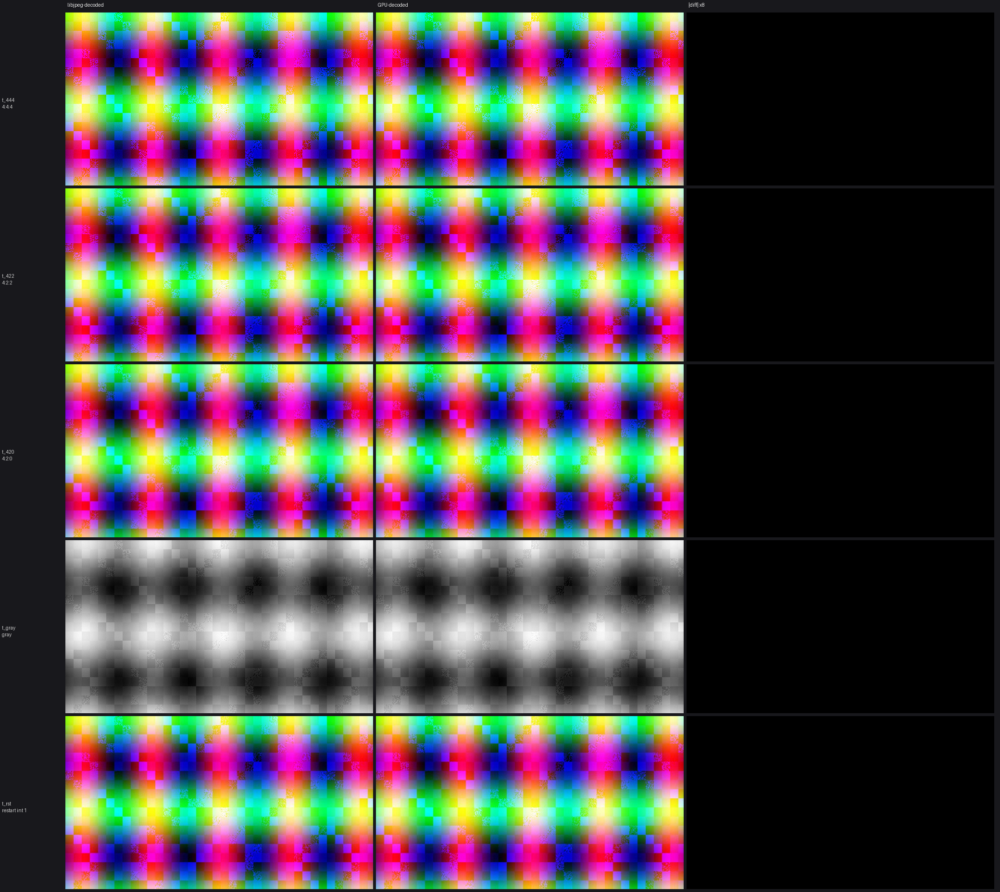

# p80_gpujpegdec — How to decode JPEG entirely on the GPU — parallel Huffman entropy decode in a compute shader

Baseline JPEG decoder in three compute passes: per-restart-interval Huffman
entropy decode → dequant + integer IDCT (libjpeg `islow`) → fancy chroma
upsampling + fixed-point YCbCr→RGB. **Bit-exact vs libjpeg-turbo** on
192 corpus files (generated + real-world + rejection cases).

**Tutorial post:** [How to decode JPEG entirely on the GPU — parallel Huffman entropy decode in a compute shader](https://techoverflow.net/2026/09/27/how-to-decode-jpeg-entirely-on-the-gpu-parallel-huffman-entropy-decode-in-a-compute-shader/)
on [TechOverflow](https://techoverflow.net).

## Build & run

```bash
g++ -std=c++23 -O2 main.cpp -o app -lvulkan -lshaderc -ljpeg
./app input.jpg out.ppm          # decode
./app --verify input.jpg         # compare against libjpeg (coefs + pixels)
./app --bench 10 input.jpg       # throughput benchmark
./check.py                       # builds + verifies the full corpus
STAGE=1 ./app in.jpg out.ppm     # per-stage timings
```

`-ljpeg` (libjpeg-turbo) is used only as the *reference*: `jpeg_read_coefficients`
verifies the entropy stage coefficient-by-coefficient, `jpeg_start_decompress`
verifies final pixels. Recon and upsample/color are fully on-GPU.

## How it works

```
JPEG file ──host marker walk──► DQT/DHT/SOF/DRI + scan span + restart offsets
        │
        ▼  entropy shader: one invocation per restart interval
        │     16-bit fused Huffman LUT (len|run|size|extended-value in 1 load)
        │     chunked 2048-MCU generations with bitstate+DC-pred handoff
        ▼  quantized coefs (zigzag i16 pairs in SSBO)
        │
        ▼  recon shader: one invocation per 8x8 block
        │     dequant + libjpeg islow integer IDCT
        ▼  component planes
        │
        ▼  upsample shader: one invocation per pixel
              libjpeg "fancy" triangle upsampling (h2v1/h1v2/h2v2,
              edge replication, alternating rounding bias)
              + fixed-point YCbCr→RGB  ──► PPM
```

Restart-interval files decode intervals **in parallel** (~430 MP/s on a
Renoir iGPU, >10x libjpeg-turbo). `DRI=0` files have one serial entropy
stream — that pass is latency-bound (~1.9 MP/s); every other stage stays
parallel. A speculative boundary-resync decoder for `DRI=0` is the known
next step (same approach production GPU JPEG decoders use).

Supported: baseline SOF0/SOF1, 8-bit, 1 or 3 components, all sampling
factors, restart markers, fill bytes. Rejected cleanly: progressive,
multi-scan, arithmetic coding, non-8-bit, >3 components, malformed tables.

## Visual comparison



`./compare.py` rebuilds if needed and writes `compare.png`:
libjpeg-decoded | GPU-decoded | |diff| x8 — all rows are flat black.
